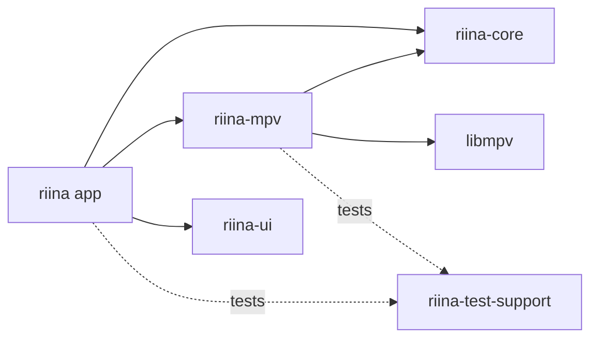
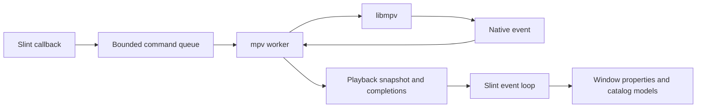

# Architecture

Riina keeps playback policy in Rust and uses libmpv for decoding and the
playback clock. Slint components display state and emit user intents. Native
window and service adapters live under `crates/app/src/platform/` and share a
facade in `crates/app/src/platform/mod.rs`.

## Workspace

| Crate | Responsibility |
|---|---|
| `riina` | Application entry point, player sessions, preferences, plugins, auxiliary windows and platform adapters |
| `riina-core` | Typed commands, native command plans, playback state, preference validation, catalogs and portable policy |
| `riina-mpv` | Native ABI, command queue, engine worker, observations and video renderer |
| `riina-ui` | Compiled Slint components shared by the application and widget tests |
| `riina-test-support` | Test-only fixture paths, isolated temporary directories and snapshot waits |
| `xtask` | Workspace checks, focused native runs and optional coverage reporting |

The `riina` executable delegates to `riina_app`. The player composition entry
point is `player/player_ui.rs`. Its feature modules install window lifecycle,
transport, audio and subtitle controls, media actions, plugins and rendering.
`PlayerContext` shares weak window access, the command sender and state needed
by UI callbacks. It does not own the native player.

`riina-core::Command::plan` routes intents to the playback, seek, audio, video,
filter, subtitle, playlist, track, capture, network and screenshot modules.
Command, preference and plugin-manifest errors retain their structured data
until a caller needs a message for the user or plugin. The engine returns
distinct errors when its command queue is full or its worker has stopped.
See [Add a playback command](recipes/add-a-command.md).

## Playback and threading

The UI thread owns windows, callbacks, timers and the preference model. The mpv
worker in `crates/mpv/src/worker.rs` serializes intents with native events. It
validates each intent against the observed `Playback` state before submitting the
plan. Its `Handle` ties each borrowed native event to the wait that returned it.
The worker copies payloads before advancing the event queue.

Callbacks and `playback_mailbox` share `Arc<Playback>` snapshots. Tracks, chapters,
playlists, audio devices and retained plugin events are shared across snapshots
until the worker replaces or updates them. `playback_mailbox` coalesces pending
updates to the UI thread.
The event-loop reservation is released when delivery begins or when the loop
discards the callback. Rendering uses the same ownership for redraw requests.
Screenshot and frame completions travel alongside the snapshot so coalescing
cannot discard their side effects. `observations` projects playback state and
catalogs into Slint. The UI observer wakes thumbnail, native transition,
subtitle discovery and material timers when a playback snapshot introduces
work for them. The playlist metadata worker notifies subscribed windows when
a lookup completes. Each player schedules a refresh of its own visible rows
and owns its audio, video, subtitle, timeline, catalog and feedback state.
The sidebar, layout, controls and dialogs read state from the owning window.
Rendered frames and material samples share
that lifetime. Keyboard input and both menu presentations invoke the actions
registered for that player. Plugin entry workers have a separate runtime and
send intents through the existing command path.

Slint has one Winit event callback per window. The player combines file drops,
focus, wheel input, trackpad gestures and shared-renderer resize events in that
callback. The framed Windows video owner registers its own event callback.

Each player retains its latest 16 engine notices. The status line and the
plugin snapshot expose the active notice. Clearing it leaves prior notices in
the history, and the engine logs each new notice when it occurs.

The app's named background tasks register until their work returns. Their
owners retain join handles where teardown depends on the work completing.
The application logs tasks still running when the main event loop exits.
UI deliveries that depend on a live window use a weak component handle.

`UiSession` releases its player ownership before the native presentation drops.
Windows native playback joins its worker before the target window can disappear.
On the shared GL route, the renderer retains player ownership until rendering
teardown frees the GL surface. The worker unregisters its wakeup callback, destroys
the native engine and only then releases the callback context.

## Preferences

`preference_load` reads and validates the startup settings. Recovery preserves a
copy of invalid input and loads recoverable fields. `PreferenceModel` holds the
committed settings on the UI thread and delegates persistence to
`preference_store::Writer`. Section bindings read and validate their controls and
project the saved settings into the Settings form and `PlayerPreferences`.
At shutdown, `session_preferences::SessionState` captures runtime settings,
recent files, and history over the model's committed settings. The model saves
that candidate through the same preference writer. See
[Add a preference](recipes/add-a-preference.md).

## Platform boundary

The Windows native presentation owns the video target used by the D3D11 route.
The platform startup adapter selects the presentation, configures the shared
backend and owns application menu integration. The shared GL renderer uses
the current Slint context. Video textures and the
blur pass use the same framebuffer binding operations. Window focus, dialog
modality, clipboard access, window document identity, file associations, and OS
media integration belong to platform services. `SessionExtras` keeps each
platform's input and auxiliary presentation alive through decoder shutdown.
Test playback can use null native output or a recording engine to exercise UI
callbacks without a native window. Windows software-rendered pixel
baselines cover the Slint surfaces. The platform service recipe shows how to
add a native query without coupling its caller to the target.
[Add a platform service](recipes/add-a-platform-service.md)

See [port development](port-development.md) and [verification](verification.md)
for runtime coverage on each target.
