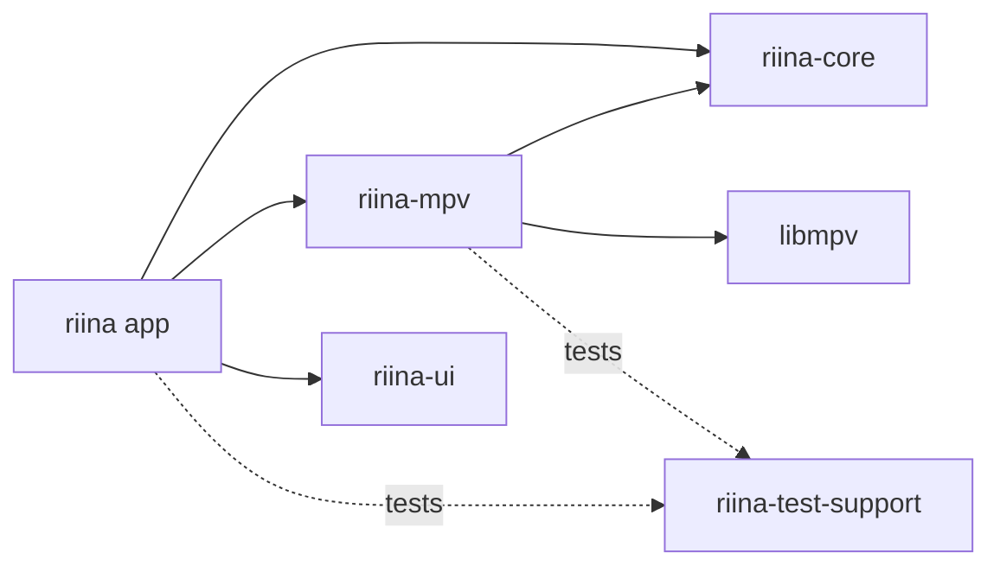
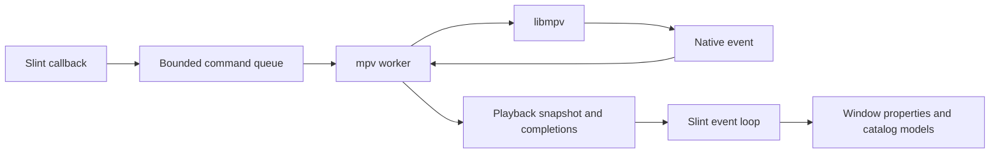

# Architecture

Riina keeps playback policy in Rust and uses libmpv for decoding and the
playback clock. Slint components display state and emit user intents. Native
window and service adapters live under `crates/app/src/platform/` and share a
facade in `crates/app/src/platform/mod.rs`.

## Workspace

| Crate | Responsibility |
|---|---|
| `riina` | Application entry point, player sessions, preferences, plugins, auxiliary windows and platform adapters |
| `riina-core` | Typed commands, native command plans, playback state, preference validation, catalogs and portable policy |
| `riina-mpv` | Native ABI, command queue, engine worker, observations and video renderer |
| `riina-ui` | Compiled Slint components shared by the application and widget tests |
| `riina-test-support` | Test-only fixture paths, isolated temporary directories and snapshot waits |
| `xtask` | Workspace checks, focused native runs and optional coverage reporting |

The `riina` executable delegates to `riina_app`. The player composition entry
point is `player/player_ui.rs`. Its feature modules install window lifecycle,
transport, audio and subtitle controls, media actions, plugins and rendering.
`PlayerContext` shares weak window access, the command sender and state needed
by UI callbacks. It does not own the native player.

`riina-core::Command::plan` routes intents to the playback, seek, audio, video,
filter, subtitle, playlist, track, capture, network and screenshot modules.
Command, preference and plugin-manifest errors retain their structured data
until a caller needs a message for the user or plugin. The engine returns
distinct errors when its command queue is full or its worker has stopped.
See [Add a playback command](recipes/add-a-command.md).

## Playback and threading

The UI thread owns windows, callbacks, timers and the preference model. The mpv
worker in `crates/mpv/src/worker.rs` serializes intents with native events. It
validates each intent against the observed `Playback` state before submitting the
plan. Its `Handle` ties each borrowed native event to the wait that returned it.
The worker copies payloads before advancing the event queue.

Callbacks and `playback_mailbox` share `Arc<Playback>` snapshots. Tracks, chapters,
playlists, audio devices and retained plugin events are shared across snapshots
until the worker replaces or updates them. `playback_mailbox` coalesces pending
updates to the UI thread.
The event-loop reservation is released when delivery begins or when the loop
discards the callback. Rendering uses the same ownership for redraw requests.
Screenshot and frame completions travel alongside the snapshot so coalescing
cannot discard their side effects. `observations` projects playback state and
catalogs into Slint. The UI observer wakes thumbnail, native transition,
subtitle discovery and material timers when a playback snapshot introduces
work for them. The playlist metadata worker notifies subscribed windows when
a lookup completes. Each player schedules a refresh of its own visible rows
and owns its audio, video, subtitle, timeline, catalog and feedback state.
The sidebar, layout, controls and dialogs read state from the owning window.
Rendered frames and material samples share
that lifetime. Keyboard input and both menu presentations invoke the actions
registered for that player. Plugin entry workers have a separate runtime and
send intents through the existing command path.

Slint has one Winit event callback per window. The player combines file drops,
focus, wheel input, trackpad gestures and shared-renderer resize events in that
callback. The framed Windows video owner registers its own event callback.

On Windows, the framed video window and its controls share one OLE drop route.
The window that receives the drop supplies its client coordinates. The route
preserves playlist hover as the pointer moves between the two windows and
queues media commands on Slint's event loop.
[Win32 drop-target interface](https://learn.microsoft.com/en-us/windows/win32/api/oleidl/nn-oleidl-idroptarget)

On Wayland, the application registers one data device per seat on Winit's
display. Winit reads the display socket and Riina dispatches its drop queue
from the same event loop. Drop payloads are read in the background, and the
compositor's surface-relative coordinates select the owning window and playlist
row. Winit keeps ownership of the display.

On macOS, AppKit routes Finder files, browser URLs and text to the Winit content
view for the player or Welcome window. A subclass adds the drag destination
methods to that view for the lifetime of its registration. AppKit supplies
the release position, and a weak route delivers the drop on Slint's event loop.
[AppKit drag destinations](https://developer.apple.com/library/archive/documentation/Cocoa/Conceptual/DragandDrop/Concepts/dragdestination.html)

Each player retains its latest 16 engine notices. The status line and the
plugin snapshot expose the active notice. Clearing it leaves prior notices in
the history, and the engine logs each new notice when it occurs.

The app's named background tasks register until their work returns. Their
owners retain join handles where teardown depends on the work completing.
The application logs tasks still running when the main event loop exits.
UI deliveries that depend on a live window use a weak component handle.

`UiSession` releases its player ownership before the native presentation drops.
Windows native playback joins its worker before the target window can disappear.
On the shared GL route, the renderer retains player ownership until rendering
teardown frees the GL surface. The worker unregisters its wakeup callback, destroys
the native engine and only then releases the callback context.

### Plugin mpv operations

The player attaches its command sender before the plugin host starts entry
scripts. Getters and setters send typed requests to that player's mpv worker.
The worker copies read replies while their native event owns the data. It
holds write values until libmpv has copied them. Only the plugin worker waits
for a reply, within the deadline of its callback. Property replies stay out
of the public playback event stream and global plugin entries have no
player engine.

Playback options follow the pinned IINA property inventory. Transport
options require a reviewed network grant. External file lists require a
filesystem grant, and URL entries also use the plugin's allowed domains.
The worker clamps volume writes to the range selected in Preferences and
updates that range in the same queue as property requests.

Plugin commands use the same queue and wait for native replies. Standard
seek, Stop and playlist actions use existing player intents. Supported
native commands carry separate arguments through to libmpv. Media loading
and external tracks use reviewed file and network access. Quit is routed
to the application's shutdown handler so the player can release its
rendering and plugin resources.

Initial media opens after enabled plugin entries have initialized. The UI can
accept another open request during startup and honors the newer request.
Hooks register on the player's native client. Each plugin realm owns its
registrations and runs the callbacks on its JavaScript worker. The native
worker keeps receiving events and answering property requests while a hook
awaits its continuation. A synchronous callback completes on return. An async
callback calls `next()` when ready. A failure, released registration, rejected
delivery or 15-second deadline releases a pending native hook. The worker
consumes each native continuation once and reuses vacant slots when that
preserves libmpv's registration order.

### Plugin subtitle providers

The plugin host catalogs the providers declared by enabled manifests. Menus and
Settings use stable provider IDs so changing the plugin list keeps the selected
provider associated with its package. Each search runs in the owning player
realm. The JavaScript objects stay in that realm. Only the display text and
result indices reach the chooser.

Downloads use the same realm that produced the selected results. The plugin
file scope resolves returned paths, and the download worker copies subtitle
files into the application cache. Search and download results carry the media
generation through to the playback worker, which checks it before attaching
the files.

### Plugin WebSocket servers

Each realm may start one WebSocket listener after permission review. A network
thread owns the listener and its connections on a single event loop. It sends
typed lifecycle, message and send-result events to the realm. Only the realm
invokes JavaScript callbacks and settles `sendText` promises. The realm's
memory limit covers incoming message bytes that a plugin retains. Text and
typed arrays are created on request.

Server replacement retires the previous listener and all its connections.
Each event identifies its listener generation so an old socket cannot update a
replacement server. Same-port replacement retains the listening endpoint while
closing the old connections so the new server can start immediately. The
listener shuts down and joins its network thread when
the realm closes, including during plugin reload. Connections, message sizes
and send queues are bounded. A busy realm pauses socket reads until delivery
can resume.

### Playlist plugin menus

The player captures the row order and selection when opening a playlist menu
from the sidebar or Music Mode. A click below the rows passes an empty
selection to each builder. The plugin host starts builders in the player
realms and gathers their replies under one deadline. Each realm owns its
callbacks and retains the latest popup's items until an action is chosen or
another request supersedes them. The UI discards replies and actions when
the observed playlist changes or the originating surface closes. The Windows
and AppKit presenters hold their menus only for the duration of popup tracking.

### Plugin input

Player realms register normalized keys and video-surface mouse events. Each
player maintains weak subscriptions to its own realms and publishes a snapshot
when installing the initial profile and applying profile changes. Publication
completes before a startup entry can read the profile. The UI calls the matching
higher-priority key listeners before the normal binding and the lower-priority
listeners afterward. A truthy reply stops propagation. Mouse-up listeners run
before the configured click action.

The UI gives both priority groups one 16 ms deadline. Input with no matching
listener proceeds immediately. Requests that expire before execution are
discarded, and a reply that arrives after the player has moved on has no effect.
Text editors, dialogs, crop controls and reserved native menus keep their own
input paths.

### Plugin utilities

The player and global realms share a utility API. Filename lookup and path
resolution follow the filesystem grant and reuse the plugin's existing path
scope. Helper execution also requires the reviewed `process-execution` grant.
A helper receives an argument vector and a limited environment. Its supervisor
reads stdout and stderr independently and delivers output and completion to
the owning realm. Each realm allows two active helpers with a two-minute
deadline and 1 MiB per output stream. Closing the realm cancels those jobs.
Native helpers run with the user's account permissions.

The `open-external` grant permits HTTP(S) links and scoped folders to open in
other applications. Local file associations also require `process-execution`,
since an association can execute native code. Utility credentials are stored
by the platform credential service under the plugin, service and account
identity. The player permits one plugin picker at a time. Picker results
return only to the requesting realm, and a stale selection is discarded.

Confirmations and text prompts share the picker slot. The JavaScript call
waits in its realm while the UI event loop keeps running. User wait time is
excluded from the remaining JavaScript turn and startup budgets. The host
signals dialog cancellation before joining its worker on shutdown. A stale
prompt closes when its realm or player retires.

## Preferences

Plugin preferences use a separate store per installed identifier and profile.
Player and global realms share pending values, and each realm uses the
package's manifest defaults when a key has no override. Explicit sync merges
pending keys into the latest saved JSON while holding the file lock, then
uses the same atomic replacement as application settings.

`preference_load` reads and validates the startup settings. Recovery preserves a
copy of invalid input and loads recoverable fields. `PreferenceModel` holds the
committed settings on the UI thread and delegates persistence to
`preference_store::Writer`. Section bindings read and validate their controls and
project the saved settings into the Settings form and `PlayerPreferences`.
At shutdown, `session_preferences::SessionState` captures runtime settings,
recent files, and history over the model's committed settings. The model saves
that candidate through the same preference writer. See
[Add a preference](recipes/add-a-preference.md).

## Platform boundary

The Windows native presentation owns the video target used by the D3D11 route.
The platform startup adapter selects the presentation, configures the shared
backend and owns application menu integration. The shared GL renderer uses
the current Slint context. Video textures and the
blur pass use the same framebuffer binding operations. Window focus, dialog
modality, clipboard access, window document identity, file associations, and OS
media integration belong to platform services. `SessionExtras` keeps each
platform's input and auxiliary presentation alive through decoder shutdown.
Test playback can use null native output or a recording engine to exercise UI
callbacks without a native window. Windows software-rendered pixel
baselines cover the Slint surfaces. The platform service recipe shows how to
add a native query without coupling its caller to the target.
[Add a platform service](recipes/add-a-platform-service.md)

See [port development](port-development.md) and [verification](verification.md)
for runtime coverage on each target.
