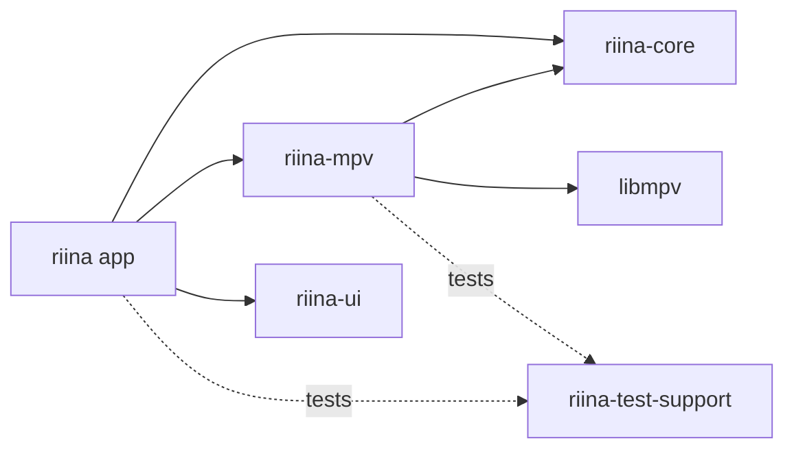
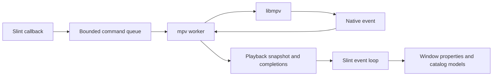

# Architecture

Riina keeps playback policy in Rust and uses libmpv for decoding and the
playback clock. Slint components display state and emit user intents. Native
window and service adapters live under `crates/app/src/platform/` and share a
facade in `crates/app/src/platform/mod.rs`.

## Workspace

| Crate | Responsibility |
|---|---|
| `riina` | Application entry point, player sessions, preferences, plugins, auxiliary windows and platform adapters |
| `riina-core` | Typed commands, native command plans, playback state, preference validation, catalogs and portable policy |
| `riina-mpv` | Native ABI, command queue, engine worker, observations and video renderer |
| `riina-ui` | Compiled Slint components shared by the application and widget tests |
| `riina-test-support` | Test-only fixture paths, isolated temporary directories and snapshot waits |
| `xtask` | Workspace checks, focused native runs and optional coverage reporting |

The `riina` executable delegates to `riina_app`. The player composition entry
point is `player/player_ui.rs`. Its feature modules install window lifecycle,
transport, audio and subtitle controls, media actions, plugins and rendering.
`PlayerContext` shares weak window access, the command sender and state needed
by UI callbacks. It does not own the native player.

`riina-core::Command::plan` routes intents to the playback, seek, audio, video,
filter, subtitle, playlist, track, capture, network and screenshot modules.
Command, preference and plugin-manifest errors retain their structured data
until a caller needs a message for the user or plugin. The engine returns
distinct errors when its command queue is full or its worker has stopped.
See [Add a playback command](recipes/add-a-command.md).

## Playback and threading

The UI thread owns windows, callbacks, timers and the preference model. The mpv
worker in `crates/mpv/src/worker.rs` serializes intents with native events. It
validates each intent against the observed `Playback` state before submitting the
plan. Its `Handle` ties each borrowed native event to the wait that returned it.
The worker copies payloads before advancing the event queue.

Windows system media controls belong to the player's native toplevel. The
session publishes observed titles, playback state and seek bounds. Native
callbacks return to the UI thread and use the player's active key profile.
The callback's published media generation must still match when it runs.
Disabling system media controls or closing the player withdraws the session
and removes its callbacks before the native window goes away.

Linux publishes one MPRIS service per application with an eligible player.
It follows the focused player while retaining the last focus when such
observations are available. Without a keyboard seat it selects the newest
ready player. The bus worker exposes a playback snapshot and queues requests.
The UI verifies the player and media generation again before dispatch.

Manual playlist navigation applies a temporary pause. The worker associates it
with the native command reply and the media generation that starts next. It
checks the current pause-on-open preference when mpv reports playback ready
after initialization. With normal latency settings, mpv waits for its video
output to finish the first frame before that event. Audio-only entries reach
the same event. An explicit pause or play command retires the temporary pause's
automatic resume.

Callbacks and `playback_mailbox` share `Arc<Playback>` snapshots. Tracks, chapters,
playlists, audio devices and retained plugin events are shared across snapshots
until the worker replaces or updates them. `playback_mailbox` coalesces pending
updates to the UI thread.
The event-loop reservation is released when delivery begins or when the loop
discards the callback. Rendering uses the same ownership for redraw requests.
Screenshot and frame completions travel alongside the snapshot so coalescing
cannot discard their side effects. `observations` projects playback state and
catalogs into Slint. The UI observer wakes thumbnail, native transition,
subtitle discovery and material timers when a playback snapshot introduces
work for them. The playlist metadata worker notifies subscribed windows when
a lookup completes. Each player schedules a refresh of its own visible rows
and owns its audio, video, subtitle, timeline, catalog and feedback state.
Visible playlists share one background duration reader. It uses a separate
paused libmpv client with null output and file references disabled. Closing a
playlist withdraws its queued requests and cancels probes that other windows
no longer need. The current player's observed duration takes precedence.
Each player reads saved resume positions for its visible playlist in one
background job. The read uses the profile's watch-later directory and the
decoder's observed filename policy. Row ordering and playback clock ticks
leave completed lookups available for the same media. Hiding the playlist
withdraws pending reads. Clearing saved playback progress invalidates the
displayed positions and supersedes any read still in flight.
Folder discovery also supplies common series filename prefixes to the
player's playlist. The grouping rules are shared with subtitle matching.
The row keeps its full title for accessibility and folds the shared part
behind a button in the sidebar and Music Mode. Expansion follows the
playlist entry when it moves. Custom titles and tagged track names retain
their own display text.
The sidebar, layout, controls and dialogs read state from the owning window.
Rendered frames and material samples share
that lifetime. Keyboard input and both menu presentations invoke the actions
registered for that player. Plugin entry workers have a separate runtime and
send intents through the existing command path.

Quick Settings timing controls keep a pointer draft inside the delay editor.
Audio drags snap to 50 ms and subtitle drags snap to half-second ticks. Release
sends one typed command to the selected lane. A lane change discards the old
draft and cancels its drag. Keyboard and accessibility slider actions submit
directly. The text editor consumes player shortcuts while it holds focus
and lets Tab and Shift-Tab move between controls.

Slint has one Winit event callback per window. The player combines file drops,
focus, wheel input, trackpad gestures and shared-renderer resize events in that
callback. The framed Windows video owner registers its own event callback.

On Windows, the framed video window and its controls share one OLE drop route.
The window that receives the drop supplies its client coordinates. The route
preserves playlist hover as the pointer moves between the two windows and
queues media commands on Slint's event loop.
[Win32 drop-target interface](https://learn.microsoft.com/en-us/windows/win32/api/oleidl/nn-oleidl-idroptarget)

The main sidebar and Music Mode share playlist row gestures and insertion
geometry. An active row drag retains its pointer in window coordinates, so the
drop indicator follows the rows while the view scrolls beneath a stationary
pointer. The scroll view owns the edge timer and stops it on release or
cancellation. Selection and metadata refresh update existing rows in place
when their identities and order are stable. Structural changes retire the
gesture before a release can act on a different order.

Playlist drags send the selected entry IDs and destination entry ID to the
engine as one request. Play Next resolves the current entry and moves the
selected entries immediately after it in playlist order. The engine plans the
ordered moves before sending them to mpv, and only selected entries move.

Playlist file actions use the selection resolved by the context menu. Trash work
runs off the UI thread and groups repeated references to the same path. Successful
moves send the original entry IDs and filenames back to the engine. The engine
skips vanished or changed entries and removes the current entry last so playback
can advance to a remaining item. Reveal groups items for Explorer, Finder or
the freedesktop file-manager service.

Playback History stores an optional decoder title beside the media reference.
Late title and duration observations update the same visit. The outline uses
media references as selection anchors across group changes and refreshes.
Moving a file to Trash refreshes availability and keeps its record available
for separate removal. Clear, remove and trash confirmations belong to the
History window. It holds one pending action, defaults focus to Cancel and
discards the action when the window closes. The application owns one History
window. Each live player registers a weak window reference and its command
sender. Focus changes update the playback destination, and player teardown
removes its registration.
The visible History window can outlive the players and asks the application to
start a player when there is no live destination. Closing it then applies the
application's last-window policy.

Playlist subtitle associations belong to the player session and use media
filenames. The subtitle picker verifies the playlist entry before saving its
selection. Manual matches load the next time the entry starts. Wrong Subtitle
clears the associations for the selected rows and inhibits automatic rematching
until Stop. A single-file open matches siblings in one background scan of the
media directory and configured subtitle locations. Rows can use those results
before playback. The results stay with the playlist as playback advances and
expire on replacement or a discovery settings change. An explicit playlist
scans each entry when it starts. The decoder accepts matched files only for
the generation that requested them.
The in-window context menu scrolls when its actions exceed the available
height in either player view.

The desktop drop adapters publish the position of a playable offer to the same
scroll view. X11 samples the native cursor after Winit reports the file list.
The sidebar and Music Mode use their current scroll offsets for the cue and
for the release position. Riina captures the destination entry's identity
before it clears the hover or hides a temporarily revealed sidebar, then
prepares the offered files off the UI thread.

On Wayland, the application registers one data device per seat on Winit's
display. Winit reads the display socket and Riina dispatches its drop queue
from the same event loop. Drop payloads are read in the background, and the
compositor's surface-relative coordinates select the owning window and playlist
row. Winit keeps ownership of the display.

On macOS, AppKit routes Finder files, browser URLs and text to the Winit content
view for the player or Welcome window. A subclass adds the drag destination
methods to that view for the lifetime of its registration. AppKit supplies
the release position, and a weak route delivers the drop on Slint's event loop.
[AppKit drag destinations](https://developer.apple.com/library/archive/documentation/Cocoa/Conceptual/DragandDrop/Concepts/dragdestination.html)

Each player retains its latest 16 engine notices. The status line and the
plugin snapshot expose the active notice. Clearing it leaves prior notices in
the history, and the engine logs each new notice when it occurs.

The app's named background tasks register until their work returns. Their
owners retain join handles where teardown depends on the work completing.
The application logs tasks still running when the main event loop exits.
UI deliveries that depend on a live window use a weak component handle.

`UiSession` releases its player ownership before the native presentation drops.
Windows native playback joins its worker before the target window can disappear.
On the shared GL route, the renderer retains player ownership until rendering
teardown frees the GL surface. The worker unregisters its wakeup callback, destroys
the native engine and only then releases the callback context.

On Windows, one application owns the event loop and all native players opened
from its windows. Each player owns its framed window, controls, timers and
playback session. Each new frame receives its own controls owner handle. Close
releases one player. Quit releases all remaining players before ending the
Windows event loop. A separately launched Riina process has its own application
owner.

Software Update is an application service shared by its players. Either menu
opens the same window and joins an in-flight scheduled check. On macOS the
service starts with the application and the idle app menu can check on demand.
The General settings edit one update policy per profile. Independent app
processes share the policy and claim a due check under a file lock. A worker retrieves public
release metadata and compares versions. A scheduled check opens the window
only when a newer release is available. The window can open the project's
release page. For a registered Windows installation, a download worker
stages the exact installer named by the release and verifies the published
size and SHA-256. Opening Setup requires a second user action. The Windows
adapter reinspects the installation and keeps the verified file read-locked
through the handoff to the shell.

Playback power also belongs to the application. The first actively playing
session in creation order determines the request. General settings can
release it or let audio and Music Mode keep only the system awake. Player
close releases that session's registration before decoder teardown. Windows
uses process-owned power requests, macOS uses a Foundation activity, and
Linux uses desktop idle inhibitors and the logind idle lock when available.
The Linux requests run off the window thread.

Media discovery chooses destination players from the original selection before
enumerating folders or filtering files. A folder stays with its assigned player,
and a standalone playlist goes to mpv as a single reference. The Windows and
shared player managers use each player's current media for duplicate checks on
separate opens. An explicit grouped selection opens together even when only one
playable item remains after filtering.

Playback History sends selected rows to the current player or to one new player
according to the chosen action. Play in New Window in the playlist menu uses
the same explicit playlist open. The engine retains the selection policy through
navigation and appends. Same-folder media discovery skips it until a regular
media open replaces it.

### Plugin mpv operations

The player attaches its command sender before the plugin host starts entry
scripts. Getters and setters send typed requests to that player's mpv worker.
The worker copies read replies while their native event owns the data. It
holds write values until libmpv has copied them. Only the plugin worker waits
for a reply, within the deadline of its callback. Property replies stay out
of the public playback event stream and global plugin entries have no
player engine.

Playback options follow the pinned IINA property inventory. Transport
options require a reviewed network grant. External file lists require a
filesystem grant, and URL entries also use the plugin's allowed domains.
The worker clamps volume writes to the range selected in Preferences and
updates that range in the same queue as property requests.

Plugin commands use the same queue and wait for native replies. Standard
seek, Stop and playlist actions use existing player intents. Supported
native commands carry separate arguments through to libmpv. Media loading
and external tracks use reviewed file and network access. Quit is routed
to the application's shutdown handler so the player can release its
rendering and plugin resources.

Initial media opens after enabled plugin entries have initialized. The UI can
accept another open request during startup and honors the newer request.
Browser activation passes one validated link through a profile-scoped local
endpoint to the application event loop. Windows restricts its named pipe to
the current logon session. Unix uses a private socket with peer checks.
The application resolves the most recently active player before choosing
append, replace or a new player. Local link delivery shares the ordinary
media generation and window presentation paths. [Named Pipe Security](https://learn.microsoft.com/en-us/windows/win32/ipc/named-pipe-security-and-access-rights)

Hooks register on the player's native client. Each plugin realm owns its
registrations and runs the callbacks on its JavaScript worker. The native
worker keeps receiving events and answering property requests while a hook
awaits its continuation. A synchronous callback completes on return. An async
callback calls `next()` when ready. A failure, released registration, rejected
delivery or 15-second deadline releases a pending native hook. The worker
consumes each native continuation once and reuses vacant slots when that
preserves libmpv's registration order.

### Plugin subtitle providers

The plugin host catalogs the providers declared by enabled manifests. Menus and
Settings use stable provider IDs so changing the plugin list keeps the selected
provider associated with its package. Each search runs in the owning player
realm. The JavaScript objects stay in that realm. Only the display text and
result indices reach the chooser.

Downloads use the same realm that produced the selected results. The plugin
file scope resolves returned paths, and the download worker copies subtitle
files into the application cache. Search and download results carry the media
generation through to the playback worker, which checks it before attaching
the files.

### Plugin WebSocket servers

Each realm may start one WebSocket listener after permission review. A network
thread owns the listener and its connections on a single event loop. It sends
typed lifecycle, message and send-result events to the realm. Only the realm
invokes JavaScript callbacks and settles `sendText` promises. The realm's
memory limit covers incoming message bytes that a plugin retains. Text and
typed arrays are created on request.

Server replacement retires the previous listener and all its connections.
Each event identifies its listener generation so an old socket cannot update a
replacement server. Same-port replacement retains the listening endpoint while
closing the old connections so the new server can start immediately. The
listener shuts down and joins its network thread when
the realm closes, including during plugin reload. Connections, message sizes
and send queues are bounded. A busy realm pauses socket reads until delivery
can resume.

### Plugin runtimes and player ownership

The application owns one global plugin host. Each enabled package can register
one global realm, which survives closing or opening a player. Player entries
run in their own playback sessions. The application host distributes package
changes to those sessions and waits for their acknowledgements before an
installer can replace an active package. Closing the application retires the
global entries.

On macOS, startup loads enabled global entries even if the selected launch
action leaves the app without a player. The coordinator wakes the UI when a
global entry requests a player or changes its standalone window, menu or
developer registration. The AppKit application menu reads published global
contributions and defers menu mutations until tracking ends. An action carries
the generation of its owning realm so a selection from before reload cannot
reach a replacement entry. The Developer Tool uses the same global console
whether or not a player is open, and retires it when its realm stops.
The application checks WebView frames and console output while the tools are
visible. Prompts and file pickers can use the application when no visible
player can host them. Plugin tools and application dialogs participate in the
same quit policy as other app-owned tools.

Settings and both plugin hosts share package discovery. Links and development
folders keep their project location, with permissions and preferences stored
in the Riina profile. If two packages declare the same identifier, discovery
assigns the additional copy an identity derived from its installed filename
while both copies are present.

Uninstall waits for the application and player hosts to retire the plugin
before moving its installed folder out of the catalog. If saving the disabled
state fails, Riina restores the package and its grants. The package lock
serializes installation, replacement, and removal while the profile keeps the
plugin's data and preferences.

A controller can reserve a player ID and ask the application to open an
independent playback session. The request uses the same reviewed file and
network access rules as the player's open API. The player starts its owner's
entry by default. A controller can opt into the full enabled plugin set.
The controller owns the player until either the window closes or the
controller retires. Reusing a numeric ID after reload creates a new ownership
token and cannot address the retired session.

Messages from a player carry its internal label to the package's controller.
A controller's numeric target selects one of its players and a null target
selects all of them. A string target resolves an ordinary player's internal
label. The user label supplied at creation is returned by the child API.
Messages sent before a new player registers stay in a bounded queue until
its entry can receive them. The application currently allows 16 live players
per controller and 32 pending launches across controllers.

### Plugin application menus

The player keeps global and player contributions grouped by their package.
Menu rows carry their depth and role up to the compiled Slint menu provider.
The provider restores the subtree before Slint supplies entries to the native
menu, the in-window menu or its shortcut dispatcher. Contributions after the
fifth top-level row of a package go into More. Leaf entries retain the item
identities that dispatch actions through the player to their owning entry.

The provider extends the pinned Slint runtime interface in the UI crate.
Slint continues to own presentation and menu lifetime on every platform.
The provider refreshes the contribution tree when Slint assigns a new root
identity after a binding change.

### Playlist context menus

The player captures the playlist entry identities, filenames and selected
indices when opening a menu in the sidebar or Music Mode. File and URL action
availability comes from that selection. Copy URLs preserves the playlist
order of supported stream URLs. The browser launcher receives eligible HTTP
and HTTPS URLs. Both commands apply when the selection also contains files.

Built-in actions share the presentation path for plugin contributions. A click
below the rows passes an empty selection to each builder. The plugin host
starts builders in the player realms and gathers their replies under one
deadline. Each realm owns its callbacks and retains the latest popup's items
until an action is chosen or another request supersedes them. The player
discards replies and activations when the playlist, selection or originating
surface changes. Win32, AppKit and GTK track native popup menus. Wayland and
the native fallback use the scrollable in-window presenter.

### Plugin input

Player realms register normalized keys and video-surface mouse events. Each
player maintains weak subscriptions to its own realms and publishes a snapshot
when installing the initial profile and applying profile changes. Publication
completes before a startup entry can read the profile. The UI calls the matching
higher-priority key listeners before the normal binding and the lower-priority
listeners afterward. A truthy reply stops propagation. Mouse-up listeners run
before the configured click action.

The UI gives both priority groups one 16 ms deadline. Input with no matching
listener proceeds immediately. Requests that expire before execution are
discarded, and a reply that arrives after the player has moved on has no effect.
Text editors, dialogs, crop controls and reserved native menus keep their own
input paths.

The installed keyboard profile resolves conflicts for plugin menu shortcuts
using the same platform key normalization as playback. The player retains the
requested shortcut so it can restore the accelerator after a profile change.
Both menu presenters receive the resolved shortcut and the conflict count.

### Plugin sidebar surfaces

Each player owns its plugin sidebar documents and selects one tab for display.
The sidebar shares the confined package protocol with the overlay and standalone
windows. It tags each document and routes browser messages to its owning plugin
instance, so an old page cannot deliver messages after that plugin is reloaded.
Windows, AppKit and X11 attach native browser children. On Wayland the selected
WebKitGTK document supplies a transparent image inside the shared sidebar. Its
pointer and wheel input uses sidebar-local coordinates. While the browser has
focus, WebKit handles text editing and the GTK shortcut adapter routes reserved
window actions to the owning player. Closing or switching tabs releases browser
focus and pending captures while retaining the document.

### Plugin video overlays

The player owns each overlay WebView. On native Windows it sits in the video
host. The shared Windows and AppKit players attach their overlays within the
video viewport. Linux renders each WebKitGTK view offscreen and composites
its premultiplied pixels above the video and below player controls. Each
visible view has at most one snapshot pending. Static pages are sampled less
often, and unchanged pixels keep the existing Slint image. The shared presenters
hide overlays during crop edits, modal dialogs and Music Mode while retaining
the documents.

Overlays and standalone plugin windows share the confined page protocol. The
page origin isolates browser storage and a document ID ties messages to the
active page. Overlay replies also carry the owning plugin realm so a retired
WebView cannot send a message to a replacement entry. Hit testing uses the last
DOM result for the current pointer position. Moving the pointer, changing the
document or hiding the view invalidates the result. On Linux the frontmost
clickable document receives the press. Its release belongs to the same document
even when the pointer moves outside the element.

### Standalone plugin windows

Each player or global entry owns one standalone window state and a distinct
browser origin. The UI reads that state and creates a native window on the
first open. Close hides the WebView so reopening retains the document. Each
open request can raise the native window even when a close and a reopen arrive
before the same UI update. Frame requests record each supplied axis so repeated
values can restore a manually moved or resized window while preserving other
axes. AppKit applies those changes to the live window frame in screen points.

When an entry retires, the UI drops its WebView and native window. The
application owns the global standalone and developer windows. On macOS, a
pending global window open participates in application lifetime while the
native shell is being created. Each player owns its own plugin windows and
queues presenter work separately from the plugin timer. The Linux global WebView
resolves application shortcuts through the current player. Global utility
dialogs use the focused player when one is available.

Package assets use a confined custom protocol. Simple-mode markup and style
can be set while the window is hidden or its page is loading. A document ID
ties bounded messages to the page that sent them. Loading another document
clears pending messages and listeners. IPC callbacks also check the owning
entry's lifetime.

Windows and AppKit use a Slint window with a native WebView. Linux uses a
GTK top-level window and WebKitGTK, with event delivery on the player UI
thread. The compositor controls final placement under Wayland.

### Plugin utilities

The player and global realms share a utility API. Filename lookup and path
resolution follow the filesystem grant and reuse the plugin's existing path
scope. Helper execution also requires the reviewed `process-execution` grant.
A helper receives an argument vector and a limited environment. Its supervisor
reads stdout and stderr independently and delivers output and completion to
the owning realm. Each realm allows two active helpers with a two-minute
deadline and 1 MiB per output stream. Closing the realm cancels those jobs.
Native helpers run with the user's account permissions.

The `open-external` grant permits HTTP(S) links and scoped folders to open in
other applications. Local file associations also require `process-execution`,
since an association can execute native code. Utility credentials are stored
by the platform credential service under the plugin, service and account
identity. The player permits one plugin picker at a time. Picker results
return only to the requesting realm, and a stale selection is discarded.

Confirmations and text prompts share the picker slot. The JavaScript call
waits in its realm while the UI event loop keeps running. User wait time is
excluded from the remaining JavaScript turn and startup budgets. The host
signals dialog cancellation before joining its worker on shutdown. A stale
prompt closes when its realm or player retires.

## Preferences

Plugin preferences use a separate store per installed identifier and profile.
Player and global realms share pending values, and each realm uses the
package's manifest defaults when a key has no override. Explicit sync merges
pending keys into the latest saved values while holding the file lock, then
uses the same atomic replacement as application settings.
An IINA property list supplies the saved values when the JSON store is absent.
Riina matches the installed identifier against the filename on disk and keeps
the original property list when a sync saves the merged values as JSON.

An installed package can declare a local `preferencesPage`. Settings opens it
in a native WebView with an isolated origin and confined package resources. Its
bridge reads the same defaults and pending values as the plugin's realms.
Form changes update that store. Closing the page, leaving Plugins, or closing
the owning Settings window saves the pending edits and releases the WebView.
The WebView uses the same native window shell as standalone plugin windows.

Plugin information in Settings shows the manifest metadata, permissions, source
and author contacts without starting the package. A declared `helpPage` can
open a confined package document or an HTTP(S) page. Help uses a private native
WebView with no plugin API, and its lifetime follows the Settings window.
GitHub update checks initiated from the information panel use the existing
package staging and permission-review flow.

Finder groups containing an IINA plugin archive route the first package to
Plugins in Settings. The local picker, Finder and GitHub installs stage
packages on a worker, then show a review dialog under the Settings window.
The reviewed package holds the package lock through placement, grant and
enable changes, and rollback. Closing Settings cancels an outstanding
review. An accepted installation can finish in the background. A supported
package with an available runtime starts after the user approves the review.

`preference_load` reads and validates the startup settings. Recovery preserves a
copy of invalid input and loads recoverable fields. `PreferenceModel` holds the
committed settings on the UI thread and delegates persistence to
`preference_store::Writer`. Section bindings read and validate their controls and
project the saved settings into the Settings form and `PlayerPreferences`.
The Settings form initializes from the saved profile before the player attaches
its live state and actions. General playback preferences and screenshot controls
use the same form projection when they refresh from a player. Screenshot edits
preserve formats and templates outside the form and project to a player after
the save succeeds. Update and playback power controls save through application
services, with failures reported by the Settings owner.
Settings search builds a localized index when the window connects. Each result
carries an index into the original actions, so keyboard and pointer activation
share the same disclosure and scroll targets. General and Interface read the
live layout after expanding a disclosure. Video search shares the rendered
card positions, including the offsets introduced by Live Text or the macOS
display profile control. Search checks feature availability on each query
because text recognition can become available after the window opens.
Audio device models keep the recorded name and description separate from the
display caption, including when the last selected device is disconnected.
The controller clock reads libmpv's elapsed, duration, remaining and scaled
remaining values. Its precision changes only the text. The slider still uses
the original clock values. A committed controller option refreshes players
and open Settings forms using the same profile, including paused players.
Clicking the right clock and selecting precision from either clock's menu
use the same persisted profile values as Settings.
The idle macOS AppKit menu opens an application-owned Settings form from the
current profile. It saves validated edits under the same profile lock as
player sessions. The store merges differences between successive form values,
which preserves concurrent changes to other fields and values rounded for
display. The form uses the application plugin host for package changes and the
shared recent-file and history services for Utilities actions. The app menu
routes to the current player when one is configured, including behind Welcome.
The idle form can remain visible when playback starts. Ordinary edits in that
form change the profile used by subsequent players.
At shutdown, `session_preferences::SessionState` saves runtime settings over
the model's committed settings. Its resume write checks the profile's current
resume revision under the preference lock. Clearing history advances the
revision so a player that was already open cannot restore the cleared entry
at shutdown.

`RecentActivity` owns each profile's Open Recent list and Welcome resume
projection at application scope. Player menus, Welcome and plugin snapshots
use the same document list. The idle macOS File menu reads that profile list
and sends opens and clears through the shared services. AppKit also records
local files in the system recent list. Open Recent can clear independently.
Settings Utilities also clears the shared Playback History archive and the
resume entries. The separate History window's Clear action edits the archive.
The Settings window owns Utilities confirmations and discards them when it
closes. A confirmed action calls its profile service once. Acknowledgements
stay on the owning window. Cache sizes refresh on entry, reopening and clearing.
See [Add a preference](recipes/add-a-preference.md) for settings changes.

The Log Viewer is application-owned. The Window menu and Advanced Settings
open the same window and share its filters and selection. On macOS the idle
Window menu can also open it. The viewer reads the
profile's diagnostic and optional mpv log in bounded batches only while it is
open. Each file keeps its original order and records from the two clocks are
combined in read order. Unchanged polls keep the current list and selection.
Export captures the chosen records before opening the viewer's save dialog.

About shares one window across player menus and the idle macOS menu. When
opened before playback, it reads the installed libmpv and FFmpeg version
properties on a background thread. The query uses a short-lived client with
null outputs and loads no media or user configuration.

The Windows and Linux Window menus share an application-owned catalog. Each
session supplies the display it owns and retires its registration before native
teardown. The catalog keeps minimized players and omits hidden playback frames
that have no visible Welcome surface. It samples window-manager state while
players exist and publishes menu rows only when titles or membership change.
Bring All to Front on X11 uses the visible surfaces and retains the initiating
player in front. macOS registers Window, Help and Services with AppKit as the
application switches between menu bars. Close, Minimize, Zoom and Bring All to
Front follow the native responder chain. Both menu bars use the same Edit menu.
Native responders, including browser editors, handle their own edits. The
adapter for Slint resolves the focused text item in the key window and uses that
item's clipboard, selection and undo history. It keeps only weak window handles.

Wayland window selection uses the guest queue on Winit's display connection.
The selected player stays weak while the compositor returns an activation
token. The request uses the latest input serial for the menu's surface and
seat. The guest queue submits the request after dispatching those input events.
A newer selection replaces a pending target.

Release Highlights and About each have one application-owned window. Highlights
reads notes bundled for the package version and opens the browser only through
its release link. The macOS Help menu keeps the guide, support links and the
debug report action available before a player opens. AppKit supplies Help search
for both menu states. A profile lock coordinates automatic launch across
processes.
The version marker is created after the guide opens. About follows the appearance
of the player that opened it and stays usable when that player closes.

Open URL is application-owned and receives the initiating player from the File
menu or Welcome. Its normal and alternate actions use the opening preference
to select a current or new player. The window keeps the address for retry when a
load fails. The worker associates each attempt with mpv's playlist entry ID,
including the successor entry for a playlist redirect. A replacement invalidates
the pending attempt before cancellation can act on the new file.

Network-first startup groups and immediate browser opens use the same stream
attempt. A group keeps the prepared file order and submits the leading load and
playlist tail through one native command plan. Discovery and the first load
share a request generation so a replacement can invalidate them together.
Browser enqueue only adds the item to the playlist. A retry keeps the original
external playback options or the grouped playlist tail. The shared window
displays the latest request. Starting a stream in another player leaves earlier
players running. Native completion is tied to the leading load command's reply,
which can precede commands that apply browser playback settings.

For HTTP authentication, the platform credential service stores an opted-in
account under the scheme, host and port. The worker applies a credentialed
address at mpv's load hook. The playlist, displayed title and watched transport
properties use the public address. [Pinned mpv command contract](https://github.com/mpv-player/mpv/blob/36abaa32d00a7229ee206aae12dc0e97e7962dca/DOCS/man/input.rst)

The Help menu's debug report takes one snapshot of each live player in creation
order. Each session registers its playback store and retires the registration
when it closes. The application writes the snapshot on a background thread.
The initiating window shows the result. The report strips user information
from standalone URLs in the title, playlist and external-track fields.

The Inspector uses the player focus events already dispatched by each window's
platform adapter. Its shared window follows the newest live player and uses
cached playback and track observations plus read-only libmpv requests. Only a
visible Inspector starts a sample, with one request in flight. Changing the
player, media generation or active tab invalidates the request before it can
update the view. The profile's watch list uses the preference store's locked
read and update path.

## Platform boundary

The Windows native presentation owns the video target used by the D3D11 route.
The platform startup adapter selects the presentation, configures the shared
backend and owns application menu integration. The shared GL renderer uses
the current Slint context. Video textures and the
blur pass use the same framebuffer binding operations. Window focus, dialog
modality, clipboard access, window document identity, file associations, and OS
media integration belong to platform services. `SessionExtras` keeps each
platform's input and auxiliary presentation alive through decoder shutdown.

macOS registers the Open Documents, Reopen, Quit and URL Apple events alongside
Winit's application delegate. Finder groups short bursts of documents before
opening them. Explicit playback requests bypass the deferred default launch
action. The shared manager prepares windowless Finder selections off the UI
thread using the saved grouping and window preferences. An AppKit Open panel
can choose files and folders in one selection, as a sheet for an existing
player or as an application panel while idle. Playback History shares its
archive and window with the idle application menu. About, Log Viewer, History,
Open URL, Software Update, Release Highlights and the audio and video filter
editors can outlive the last player.
The idle Window menu is registered
with AppKit, and the quit decision is deferred until the final tool closes.
Closing a tool before any player opened leaves the application available.
The idle Playback, Video, Audio and Subtitles sections read the generated
player menu catalog without showing a player or starting a decoder. Their
profile shortcuts, static choices and saved filter names use the same models
as playback, including translated menu labels. The hidden catalog supplies
stable keys for menu families and the commands available while idle. The
AppKit dispatcher uses those keys to open the screenshot folder or the two
filter editors. A similarly named saved preset retains its own menu entry.

The application, File, Edit, Plugin, Window and Help labels come from a shared
Slint catalog. AppKit uses a snapshot of those labels to build the idle menus and
identify the generated player menus. The idle owner retains its submenu handles
and identifies the mutable File items by tag. The native Plugin observers use
the localized caption to resolve the current platform menu.

The Windows owner formats its informational rows through the same localized
messages as the shared menu. It refreshes volume, speed and delays in place
as each native submenu opens, preserving the menu and video client's bounds.

The Linux player's title strip uses the shared in-client popup presenter.
At regular widths a title opens its menu directly, and moving the
pointer to another title switches menus. When the localized titles would
overflow, a Menu button opens the full list of families. Both layouts scroll
long lists, support Home and End, and add a Back row when a submenu overlaps
its parent. The generated bar owns shortcuts, and resizing dismisses the popup.

The application owns one audio and one video filter editor for the profile.
Both read saved presets before playback and follow the last active player when
a playback session is available. Changes to the active filter chain are checked
against the displayed player, media generation and filter list before positional
edits are sent. Preset edits merge into the latest profile under its write lock,
and every registered player's menu and keyboard shortcuts use the shared saved
list. Windows and Linux defer the last-player shutdown decision while a filter
editor is visible.
[AppKit application event handling](https://developer.apple.com/documentation/appkit/nsapplication)
[AppKit recent documents](https://developer.apple.com/documentation/appkit/nsdocumentcontroller)
[AppKit Window menu](https://developer.apple.com/documentation/appkit/nsapplication/windowsmenu)
[AppKit Help menu](https://developer.apple.com/documentation/appkit/nsapplication/helpmenu)

The player keeps pending fullscreen intent separate from the observed
presentation. Windows confirms through its native owner. macOS uses AppKit
window notifications, Wayland uses compositor configure state, and X11 uses
the window manager's EWMH state. The shared controller applies playback
preferences and exits Picture in Picture on confirmed transitions. Music Mode
waits for the fullscreen exit before resizing the window.

A confirmed fullscreen change refreshes the paused frame and closes an active
crop or delogo editor before applying the window's playback preference. On
Wayland, the player can repeat the native fullscreen request when both axes
remain substantially smaller than the output. It waits for the undersized frame
to be presented, then retries once for the current output mode. The compositor
still owns the geometry.

Fullscreen, Music Mode, and Picture-in-Picture confirmations enter the player's
plugin command queue in order. The periodic window snapshot tracks geometry,
focus, minimization, and displays. During each mode callback and its Promise
jobs, the plugin sees the presentation state from that transition.

The Windows framed player owns native file pickers. Both player surfaces are
blocked until the picker result reaches its caller, then the controls regain
input through local Win32 activation. Picture-in-Picture observes minimize and
restore changes on that same framed owner. Closing the preview restores the
placement it took over when entering and preserves moves made while the main
window remained open.

On Linux, the Picture-in-Picture preview uses the player's existing libmpv
render context. A fenced pixel buffer transfers bounded SDR frames into the
preview's independent Slint window. The player can draw into this buffer on
its own GL context when the main surface stops drawing. The X11 adapter owns
window visibility and minimize transitions. The Wayland compositor owns
placement and keeps control of the main surface's visibility.

Test playback can use null native output or a recording engine to exercise UI
callbacks without a native window. Windows software-rendered pixel
baselines cover the Slint surfaces. The platform service recipe shows how to
add a native query without coupling its caller to the target.
[Add a platform service](recipes/add-a-platform-service.md)

See [port development](port-development.md) and [verification](verification.md)
for runtime coverage on each target.
